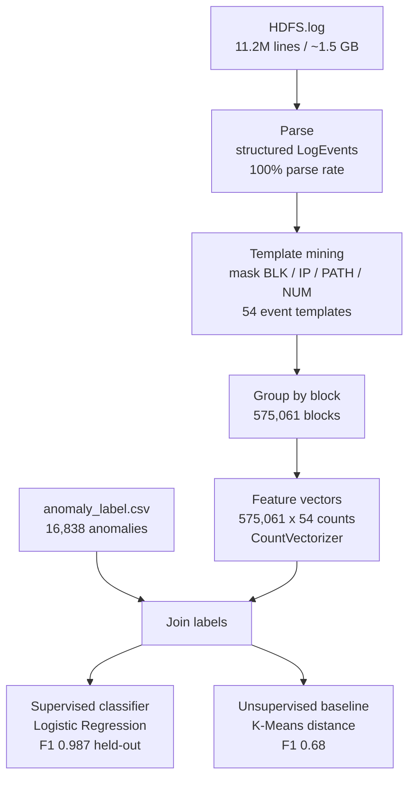

# logscope

[](https://github.com/Arjun7114/logscope/actions/workflows/ci.yml)


Distributed log anomaly detection in **Scala + Apache Spark**, built end to end over
the full **HDFS_v1** dataset: **11,175,629 raw log lines (~1.5 GB) → 575,061 per-block
feature vectors → anomaly detection**, evaluated against ground-truth labels.

This is the distributed, at-scale counterpart to an earlier single-node
(pandas / scikit-learn) log-anomaly experiment that ran on a small sample. The goal
here is to process the **entire** corpus and honestly measure how it behaves at scale.

## Architecture



## What it does

1. **Parse** 11.2M raw HDFS log lines into structured events — 100% parse rate.
2. **Template mining** — mask variable parts (block ids, IPs, paths, numbers) to
   collapse messages into **54 event templates**.
3. **Feature engineering** — group events by HDFS block into a per-block event-count
   vector (575,061 blocks × 54 templates; 4.17M non-zero cells).
4. **Detection** — classify each block Normal/Anomaly, evaluated on a held-out split.

## Results

### Detection — supervised, held-out 30% test set (172,585 blocks)

| Metric | Value |
|---|---|
| Precision | 0.979 |
| Recall | 0.995 |
| F1 | 0.987 |
| ROC AUC | 0.999 |

### Method comparison

| Method | Type | F1 |
|---|---|---:|
| Logistic Regression | supervised | **0.987** |
| K-Means distance | unsupervised | 0.68 |
| PCA reconstruction error | unsupervised | 0.68 |

Both unsupervised methods plateau around **F1 0.68** on this feature representation;
the supervised model, using the labels, is far stronger. Unsupervised scores use the
labels only to evaluate, never to train.

> **Honest note:** HDFS_v1 is a well-known, highly *separable* benchmark, so strong
> supervised scores are expected and are **not** a novel ML result. This project is
> about the end-to-end **distributed pipeline, the scale, and the methodology**
> (proper train/test split, no label leakage) — not beating state of the art.

### Scale — data-processing stage, single machine, Spark `local[N]`

| Cores | Elapsed | Throughput | Speedup |
|---:|---:|---:|---:|
| 1 | 450.8 s | 24,793 lines/s | 1.00× |
| 2 | 281.2 s | 39,745 lines/s | 1.60× |
| 4 | 174.9 s | 63,913 lines/s | 2.58× |
| 8 | 118.4 s | 94,359 lines/s | **3.81×** |
| 20 | 138.2 s | 80,848 lines/s | 3.26× |

Throughput peaks at **8 cores (3.81×)** and regresses past the physical-core count —
on a single machine, shuffle and I/O overhead outweigh extra threads. Full analysis in
[`BENCHMARKS.md`](BENCHMARKS.md). Single-machine, single-run numbers — indicative, not precise.

### Correctness checks
Pipeline outputs match the dataset's published ground truth: **575,061** distinct
blocks and **16,838** labeled anomalies.

## Project structure

```
logscope/
├── src/
│   ├── main/scala/
│   │   ├── LogParser.scala     # pure parsing + template masking (unit-tested)
│   │   ├── Main.scala          # full detection pipeline
│   │   └── Benchmark.scala     # scaling benchmark harness
│   └── test/scala/
│       └── LogParserSpec.scala
├── BENCHMARKS.md
├── build.sbt
└── .github/workflows/ci.yml
```

## Stack
Scala 2.13 · Apache Spark 3.5 (SQL + MLlib) · sbt · ScalaTest · GitHub Actions CI

## Running

```bash
# unit tests
sbt test

# full detection pipeline (needs data/HDFS_v1/HDFS.log — see Dataset)
sbt "runMain Main data/HDFS_v1/HDFS.log"

# scaling benchmark at N cores
sbt "runMain Benchmark data/HDFS_v1/HDFS.log local[8]"
```

## Packaging

Build a self-contained fat jar (Spark bundled; Java-17 `--add-opens` flags baked into
the manifest, so it runs with a plain `java -jar`):

```bash
sbt assembly          # -> target/scala-2.13/logscope.jar
```

Run it standalone — no sbt or separate Spark install needed:

```bash
java -jar target/scala-2.13/logscope.jar data/HDFS_v1/HDFS.log
```

Or submit it to a Spark cluster:

```bash
spark-submit --class Main target/scala-2.13/logscope.jar data/HDFS_v1/HDFS.log
```

## Dataset
HDFS_v1 from the Loghub collection (not committed; ~1.5 GB). Download `HDFS_v1.zip`
from Zenodo and unzip into `data/HDFS_v1/` so that `data/HDFS_v1/HDFS.log` and
`data/HDFS_v1/preprocessed/anomaly_label.csv` exist.

## Limitations / honest notes
- Benchmarks are single-machine (local mode) and single-run.
- Template count (54) depends on masking granularity; other parsers report ~29–48.
- HDFS_v1 is highly separable; supervised metrics reflect that, not a novel model.